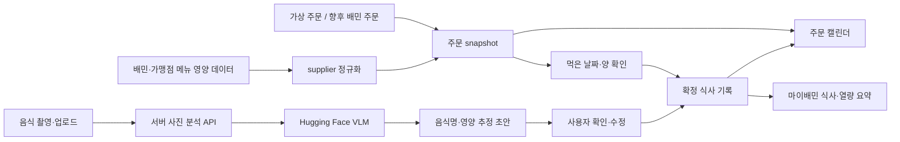

# 두 가지 영양 데이터의 연결 설계

확인일: 2026-10-26. 구현된 로컬 흐름과 향후 연동을 구분한다.



## A. 배달음식: 공급 영양 데이터

다음은 제안 계약이며 실제 배민 API 명세가 아니다. 메뉴 공급자는 버전·출처·제공량·영양 단위를 명확히 전달해야 한다.

```json
{
  "menuId": "merchant-menu-42",
  "menuVersion": "2026-10-26-v1",
  "origin": "supplier",
  "sourceId": "baemin-partner-feed",
  "retrievedAt": "2026-10-26T03:00:00+09:00",
  "basis": "per_serving",
  "servingGrams": 350,
  "nutrients": {
    "calories": {"value": 620, "unit": "kcal"},
    "carbs": {"value": 88, "unit": "g"},
    "protein": {"value": 21, "unit": "g"},
    "fat": {"value": 20, "unit": "g"}
  }
}
```

숫자는 계약 예시다. `normalizeSupplierNutrition(feed, {menuId, menuVersion})`는 메뉴·버전 일치와 단위를 확인하고, `per_100g`일 때 `servingGrams/100`을 곱한다. 데이터가 없는 경우 `nutrients: null` → `status: unavailable, nutrition: null`을 반환한다. 미제공을 0kcal로 바꾸지 않는다.

현재 실행 카탈로그는 이 정규화 함수를 `origin: fixture`로 통과한다. 실제 공급 레코드 수신·인증·DB 적재는 아직 없다. 실제 연동 시에는 다음이 필요하다.

1. 공급자 인증과 허용 메뉴 매핑, 주문 당시 메뉴/옵션 버전에 대한 영양 레코드 선택.
2. 옵션·수량·반반 메뉴·세트 메뉴·가식부 기준 정의. 중복해서 수량을 곱하지 않도록 기준량 보존.
3. 주문 품목 snapshot에 영양값과 출처·버전을 함께 저장. 카탈로그가 바뀌어도 과거 식사 수치를 소급 변경하지 않음.
4. 미제공 메뉴에서는 영양 미등록을 표시하고 사진/직접 입력으로 이어 주기. 현재 UI 카탈로그는 모두 영양 fixture가 있는 메뉴로 제한되어 있다.

`origin: supplier`는 출처 표기일 뿐 인증 결과가 아니다. 운영에서는 제공자 인증과 provenance를 서버에서 검증해야 한다.

## B. 배달 외 음식: 사진 분석

현재 서버 인터페이스:

```text
GET  /api/config
POST /api/photo-analyze
```

요청:

```json
{
  "mode": "huggingface",
  "image": "data:image/jpeg;base64,...",
  "consent": true
}
```

응답:

```json
{
  "name": "채소 비빔밥",
  "nutrition": {"calories": 620, "carbs": 88, "protein": 21, "fat": 20},
  "ingredients": ["밥", "채소", "달걀"],
  "source": "hf-estimate",
  "modelId": "Qwen/Qwen2.5-VL-7B-Instruct:featherless-ai",
  "note": "사진과 조리법·분량에 따라 달라지는 추정값입니다. 먹은 양을 확인해 주세요."
}
```

수치는 형식 예시다. 사진 선택 시 브라우저가 JPG로 재인코딩·크기 축소한 이미지를 전송한다. 서버는 토큰을 환경변수에서 읽고 이미지를 파일로 저장하거나 요청 본문을 로그로 남기지 않는다. 사용자가 저장하면 썸네일은 해당 브라우저 localStorage에 남는다. 모델/제공자 측 보관 정책은 별도로 확인해야 한다.

모델 출력은 JSON·필수 필드·유한한 비음수 수치·단위 범위를 확인한다. 음식이 아니거나 해석 불가하면 오류를 반환한다. 실패를 성공 데모로 대체하지 않는다. API에서 내려온 이름·재료를 HTML로 실행하지 않고 문자로 표시한다.

현재 확인한 모델 후보:

| 후보 | 확인된 역할 | 이 구현에서의 위치 |
| --- | --- | --- |
| [Qwen2.5-VL-7B-Instruct](https://huggingface.co/Qwen/Qwen2.5-VL-7B-Instruct) | 이미지·텍스트를 받는 범용 VLM | 교체 가능한 기본 HF 호출 모델. 음식·분량·영양값은 추정이며 실제 음식 정확도 미평가 |
| [nateraw/food](https://huggingface.co/nateraw/food) | Food-101 이미지 분류 | 음식 이름 후보용. 영양값·중량 출력을 직접 제공하는 모델로 쓰지 않음 |
| [calorie-lens](https://huggingface.co/shalev396/calorie-lens) | 재료·중량·영양 추정 전용 모델 | 별도 배포/어댑터 평가 후보. 현재 실행 버전에 설치·실행하지 않음 |

2026-10-26 Hub metadata 조회에서 Qwen2.5-VL-7B의 featherless-ai 매핑이 live, calorie-lens는 공급자 매핑 없음으로 나타났다. 메타데이터는 계정별 호출 성공이나 이미지 입력 성공을 증명하지 않는다. 토큰을 설정한 뒤 실제 요청으로 확인해야 한다.

[HF 이미지·텍스트 API 문서](https://huggingface.co/docs/inference-providers/tasks/image-text-to-text), [Chat Completion 명세](https://huggingface.co/docs/inference-providers/tasks/chat-completion)를 기준으로 서버 어댑터를 작성했다. 특정 모델이 음식 영양을 정확히 측정한다고 가정하지 않는다.

## C. 정확도 확인 계획

- 사진별 음식명, 재료, 제공량(g), 조리·영양 기준값을 갖춘 한국 음식 평가셋을 준비한다.
- 음식명 일치와 영양 오차를 나눠 평가한다. 분량 입력 전후, 혼합 음식·국물·소스·가려진 음식도 비교한다.
- 열량·탄단지의 절대오차/상대오차와 미인식 비율을 기록한다. 모델이 반환한 임의의 confidence를 검증된 정확도로 표시하지 않는다.
- 확인 화면에서 음식명·분량·영양값을 수정할 수 있게 유지한다. 실제 공급 데이터와 AI 추정, 데모값을 같은 ‘측정값’으로 합치지 않는다.

## D. 저장·향후 운영 경계

- 지금은 단일 브라우저 localStorage를 사용하는 로컬 시연이다. 서버 DB나 사용자 계정·로그인은 없다.
- `analysisId`로 사진 확인 중복 저장을 막고, `orderId`로 동일 주문의 중복 식사 기록을 막는다.
- 주문일 `placedAt`, 완료일 `completedAt`, 식사일 `date`를 분리한다. 집계 날짜는 Asia/Seoul 기준이다.
- 사진 AI의 원래 분석값과 사용자 수정값을 함께 감사 이력으로 보관하는 것은 운영 버전의 후속 범위다. 현 버전은 최종 확인값·출처·모델 ID를 보존한다.
- 실제 배민 데이터 연동은 정식 제공 경로가 확보된 뒤 공급자 어댑터를 추가한다. 스크래핑·비공개 API 호출로 대체하지 않는다.
